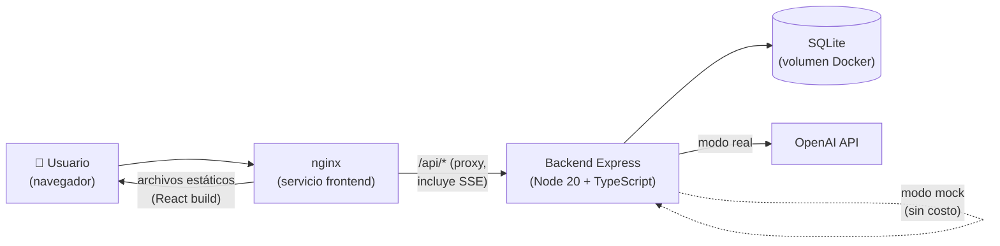

# Charla 💬

Tutor de inglés conversacional con IA para hispanohablantes. En vez de ejercicios sueltos estilo Duolingo, **Charla** te hace practicar charlando en inglés con personajes de IA (un mozo, una entrevistadora, un recepcionista) en escenarios cotidianos, corrige tus errores en tiempo real y te arma ejercicios personalizados según las categorías donde más te equivocás.

Trabajo práctico final — IISAIA.

## Funcionalidad

1. Login (mockeado, con dos usuarios demo).
2. Elegís un escenario y un nivel (A2/B1/B2).
3. Chateás en inglés con un personaje de IA que actúa ese rol.
4. Cada uno de tus mensajes se analiza en paralelo y te muestra las correcciones (categoría, explicación en español) sin cortar la conversación.
5. Tus errores arman un perfil de debilidades por categoría.
6. Dashboard de progreso con gráficos y ejercicios generados por IA enfocados en tus debilidades.
7. Al terminar una sesión, la IA genera un resumen con puntaje, fortalezas y cosas para mejorar.
8. Gamificación: XP por mensajes sin errores, por ejercicios correctos y por sesión completada, más racha de días consecutivos.

## Arquitectura



- **Frontend**: React 18 + Vite + TypeScript + Tailwind, servido por nginx (que también hace de proxy reverso hacia el backend, incluyendo streaming SSE).
- **Backend**: Express + TypeScript + Prisma + Zod. Expone `/api/*`.
- **Base de datos**: SQLite en un volumen de Docker (`charla-data`).
- **IA**: SDK de `openai`, con un modo mock que simula respuestas realistas (streaming incluido) para no gastar créditos durante el desarrollo/demo.

## Cómo levantarlo

```bash
cp .env.example .env
docker compose up --build
```

La app queda en **http://localhost:5173**. El backend corre internamente en el puerto 4000 (accesible vía el proxy de nginx en `/api`).

Al arrancar, el backend corre `prisma migrate deploy` y un seed idempotente (podés bajar y levantar los contenedores sin perder ni duplicar datos, gracias al volumen `charla-data`).

### Usuarios demo

| Email | Contraseña | Nivel |
|---|---|---|
| ana@charla.dev | charla123 | B1 (con historial de ejemplo precargado) |
| tomas@charla.dev | charla123 | A2 |

### Modo mock vs. modo real de IA

Por defecto (`AI_MOCK_MODE=true` en `.env`), **todos los servicios de IA funcionan sin necesidad de una API key**: el corrector usa heurísticas que detectan errores típicos de hispanohablantes (ej. "I have 25 years", "arrive to"), el personaje responde con frases canned troceadas para simular streaming, y los ejercicios/resúmenes salen de plantillas. Así se puede demostrar y testear la app sin gastar créditos de OpenAI.

Para usar IA real:

```
OPENAI_API_KEY=sk-...
AI_MOCK_MODE=false
```

y reiniciar el backend (`docker compose up --build backend`).

## Correr sin Docker (desarrollo)

```bash
# Backend
cd backend
npm install
cp ../.env.example .env   # y completar DATABASE_URL="file:./data/dev.db"
npx prisma migrate deploy
npm run seed
npm run dev                # http://localhost:4000

# Frontend (en otra terminal)
cd frontend
npm install
npm run dev                # http://localhost:5173, con proxy de Vite a localhost:4000
```

## Endpoints de la API

Prefijo `/api`. Todos requieren `Authorization: Bearer <token>` salvo `/auth/login` y `/health`.

| Método | Endpoint | Descripción |
|---|---|---|
| GET | `/health` | Healthcheck |
| POST | `/auth/login` | Login mock, devuelve `{ token, user }` |
| GET | `/auth/me` | Usuario actual (XP, racha, nivel) |
| GET | `/scenarios?level=` | Lista de escenarios, filtro opcional por nivel |
| POST | `/sessions` | Crea una sesión de conversación `{ scenarioId }` |
| GET | `/sessions` | Historial de sesiones del usuario |
| GET | `/sessions/:id` | Sesión con mensajes y correcciones |
| POST | `/sessions/:id/messages` | Envía un mensaje. Responde por **Server-Sent Events**: `correction` → `token`* → `done` |
| POST | `/sessions/:id/finish` | Cierra la sesión, genera el resumen y suma XP |
| GET | `/progress/summary` | Errores por categoría, top 3 debilidades, totales |
| GET | `/progress/timeline` | Errores por día (últimos 30 días) |
| POST | `/exercises/generate` | Genera 5 ejercicios según las debilidades del usuario |
| POST | `/exercises/:id/answer` | Evalúa la respuesta a un ejercicio |

## Decisiones de diseño

- **Dos llamadas de IA separadas (tutor + corrector)**: si el mismo modelo tuviera que actuar en personaje *y* corregir a la vez, o corrige y rompe la inmersión del rol, o no corrige. Separarlas permite que el personaje siga la conversación con naturalidad mientras el corrector analiza el mensaje con su propio prompt, enfocado y con `temperature: 0`.
- **Structured Outputs para el corrector, generador de ejercicios y resumen**: forzar un JSON Schema estricto evita parsear texto libre y permite validar la respuesta con Zod antes de guardarla o mostrarla, con un fallback seguro si la IA falla o devuelve algo inesperado.
- **SQLite**: para un TP no hace falta levantar una base externa; con Prisma, migrar a Postgres en el futuro es sólo cambiar `provider` y `DATABASE_URL` en `schema.prisma`.
- **SSE en vez de WebSockets**: el flujo es unidireccional (backend → cliente) y sencillo de implementar sobre HTTP; sólo requiere cuidar el buffering de nginx.
- **Campos "enum" como `String` en Prisma**: el conector SQLite de Prisma no soporta `enum` nativo, así que se validan como uniones de TypeScript + Zod en la capa de aplicación.

## Tests

```bash
cd backend
npm test          # Vitest: corrector con IA mockeada, XP/racha, validación de schemas
npm run typecheck # tsc --noEmit
```

En el frontend:

```bash
cd frontend
npm run typecheck # tsc --noEmit
```
