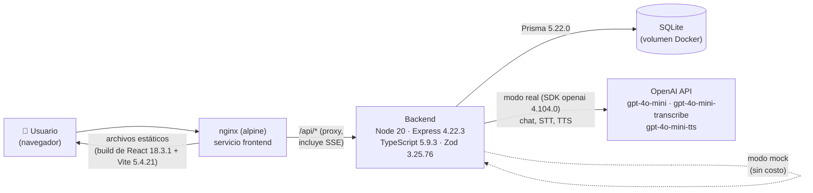
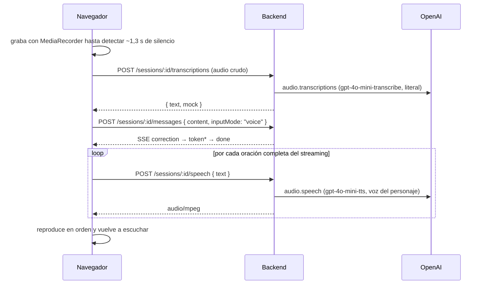

# Charla 💬

Tutor de inglés conversacional con IA para hispanohablantes. En vez de ejercicios sueltos estilo Duolingo, **Charla** te hace practicar charlando en inglés con personajes de IA (un mozo, una entrevistadora, un recepcionista) en escenarios cotidianos, corrige tus errores en tiempo real y te arma ejercicios personalizados según las categorías donde más te equivocás.

Trabajo práctico final — IISAIA.

## Funcionalidad

1. Registro básico (nombre, email, contraseña y nivel) y login con email y contraseña (bcrypt + JWT), con bloqueo temporal tras varios intentos fallidos. También se puede entrar con los usuarios demo precargados.
2. Elegís un escenario y un nivel (A2/B1/B2).
3. Chateás en inglés con un personaje de IA que actúa ese rol.
4. Cada uno de tus mensajes se analiza en paralelo y te muestra las correcciones (categoría, explicación en español) sin cortar la conversación.
5. Tus errores arman un perfil de debilidades por categoría.
6. Dashboard de progreso con gráficos y ejercicios generados por IA enfocados en tus debilidades.
7. Al terminar una sesión, la IA genera un resumen con puntaje, fortalezas y cosas para mejorar.
8. Gamificación: XP por mensajes sin errores, por ejercicios correctos y por sesión completada, más racha de días consecutivos.
9. **Modo voz**: charlás hablando, como en una conversación real. Decís tu mensaje en inglés, se transcribe (speech-to-text), se corrige igual que un mensaje escrito, y el personaje te responde en voz alta (text-to-speech) con una voz propia. Cuando termina de hablar, el micrófono se vuelve a abrir solo.
10. **Panel de administración** para el dueño de la app: una cuenta de administrador que no practica y ve estudiantes activos, uso (sesiones, mensajes, modo voz, ejercicios, topes del límite diario), escenarios más usados, errores más comunes de todos los estudiantes, una tabla por usuario y el registro de accesos (logins exitosos, fallidos y bloqueados, con IP y dispositivo). Comparte el estilo visual de la app del estudiante, pero se identifica con la etiqueta "ADMIN", un aviso de sólo lectura y su propia navegación; tiene gráficos de uso: mensajes por día (escritos y por voz), estudiantes activos y sesiones por día, uso por estudiante, escenarios más usados y el detalle de actividad de cada estudiante.

## Arquitectura



- **Frontend**: React 18 + Vite + TypeScript + Tailwind, servido por nginx (que también hace de proxy reverso hacia el backend, incluyendo streaming SSE).
- **Backend**: Express + TypeScript + Prisma + Zod. Expone `/api/*`.
- **Base de datos**: SQLite en un volumen de Docker (`charla-data`).
- **IA**: SDK de `openai`, con un modo mock que simula respuestas realistas (streaming incluido) para no gastar créditos durante el desarrollo/demo.
- **Voz**: speech-to-text con `gpt-4o-mini-transcribe` y text-to-speech con `gpt-4o-mini-tts`, ambos a través del backend (el navegador sólo graba y reproduce audio).

### Versiones

Versiones instaladas según los `package-lock.json` (en `package.json` se declaran con rango `^`, así que un `npm install` sin lockfile puede traer minors más nuevas). Los modelos de OpenAI son los valores por defecto y se cambian por variables de entorno.

| Capa | Tecnología | Versión |
|---|---|---|
| Runtime | Node.js (imagen `node:20-alpine`) | 20 |
| Servidor web | nginx (imagen `nginx:alpine`) | última de la imagen |
| Frontend | React / React DOM | 18.3.1 |
| | Vite | 5.4.21 |
| | TypeScript | 5.9.3 |
| | Tailwind CSS | 3.4.19 |
| | TanStack Query | 5.103.2 |
| | React Router | 6.30.6 |
| | Recharts | 2.15.4 |
| Backend | Express | 4.22.3 |
| | TypeScript | 5.9.3 |
| | Prisma / @prisma/client | 5.22.0 |
| | Zod | 3.25.76 |
| | SDK `openai` | 4.104.0 |
| | jsonwebtoken | 9.0.3 |
| | bcryptjs | 2.4.3 |
| | helmet | 7.2.0 |
| | Vitest | 2.1.9 |
| Base de datos | SQLite (embebido en el motor de Prisma) | — |
| IA | Chat / STT / TTS | `gpt-4o-mini` / `gpt-4o-mini-transcribe` / `gpt-4o-mini-tts` |

### Flujo del modo voz



## Cómo levantarlo

```bash
cp .env.example .env
docker compose up --build
```

La app queda en **http://localhost:5173**. El backend corre internamente en el puerto 4000 (accesible vía el proxy de nginx en `/api`).

Al arrancar, el backend corre `prisma migrate deploy` y un seed idempotente (podés bajar y levantar los contenedores sin perder ni duplicar datos, gracias al volumen `charla-data`).

### Variables de entorno

Se definen en `tp-final/.env` (copiado de `.env.example`) y se validan al arrancar el backend (`backend/src/config/env.ts`).

| Variable | Default | Uso |
|---|---|---|
| `JWT_SECRET` | — (obligatoria) | Firma de los tokens de sesión. Mínimo 8 caracteres; **cambiá el valor de ejemplo** antes de exponer la app: con él, cualquiera podría firmar tokens válidos. |
| `AI_MOCK_MODE` | `true` | `true` = IA simulada, sin costo. Sólo el texto exacto `true` la activa. |
| `OPENAI_API_KEY` | vacío | Necesaria para el modo real. Si está vacía, la IA queda en mock aunque `AI_MOCK_MODE=false`. |
| `OPENAI_MODEL` | `gpt-4o-mini` | Modelo de chat (tiene que soportar Structured Outputs). |
| `OPENAI_STT_MODEL` | `gpt-4o-mini-transcribe` | Speech-to-text del modo voz. |
| `OPENAI_TTS_MODEL` | `gpt-4o-mini-tts` | Text-to-speech del modo voz. |
| `DAILY_MESSAGE_LIMIT` | `60` | Mensajes de chat por estudiante por día. |
| `DATABASE_URL` | `file:./data/dev.db` | En Docker la fija `docker-compose.yml` (`file:/app/data/charla.db`). |
| `PORT` | `4000` | Puerto interno del backend. |

### Usuarios demo

| Email | Contraseña | Perfil |
|---|---|---|
| ana@charla.dev | charla123 | B1 · racha de 5 días, 8 sesiones y 10 ejercicios en las últimas 2 semanas |
| tomas@charla.dev | charla123 | A2 · racha de 10 días, 10 sesiones (una por día) y 10 ejercicios |
| admin@charla.dev | charlaadmin | **Administrador**: entra directo al panel (`/admin`); no puede practicar |

Los dos estudiantes traen un **historial de uso precargado** para que se vean las sugerencias de la app desde el primer login: puntos débiles en el dashboard (Tomás: preposiciones, tiempos verbales y artículos; Ana: tiempos verbales, preposiciones y artículos), gráficos de progreso con errores en baja, resúmenes de cada sesión con mejoras y tips, y ejercicios ya resueltos. Las fechas son relativas al día en que se crea la base. El historial se carga sólo si el usuario no tiene sesiones; para regenerarlo en una base existente: `docker compose down -v && docker compose up --build` (borra todos los datos).

El administrador ve desde el primer login las estadísticas de ese historial y un registro de accesos de demo (un login por cada día que practicó cada estudiante, más algunos intentos fallidos).

Después de **5 intentos fallidos** con el mismo email, el login queda bloqueado **15 minutos** (`429`). El contador vive en memoria: reiniciar el backend lo limpia.

### Modo mock vs. modo real de IA

Por defecto (`AI_MOCK_MODE=true` en `.env`), **todos los servicios de IA funcionan sin necesidad de una API key**: el corrector usa heurísticas que detectan errores típicos de hispanohablantes (ej. "I have 25 years", "arrive to"), el personaje responde con frases canned troceadas para simular streaming, y los ejercicios/resúmenes salen de plantillas. Así se puede demostrar y testear la app sin gastar créditos de OpenAI.

Para usar IA real:

```
OPENAI_API_KEY=sk-...
AI_MOCK_MODE=false
```

y reiniciar el backend (`docker compose up --build backend`).

En modo mock el **modo voz** también funciona: la transcripción devuelve frases de ejemplo (con errores típicos, para que el corrector tenga qué marcar) en vez de lo que dijiste (la UI lo avisa), y la voz del personaje la pone el navegador (Web Speech API). En modo real se usan los modelos `OPENAI_STT_MODEL` y `OPENAI_TTS_MODEL` (ver [Variables de entorno](#variables-de-entorno)). Para STT también sirven `gpt-4o-transcribe` o `whisper-1`; con `tts-1`/`tts-1-hd` no se mandan las instrucciones de tono y ritmo.

### Requisitos del modo voz

- Un navegador con `MediaRecorder` y Web Audio (Chrome, Edge, Firefox o Safari recientes) y permiso de micrófono.
- El micrófono sólo está disponible en contextos seguros: `http://localhost:5173` funciona, pero desde otro dispositivo (ej. el celular, por la IP de la PC) hay que entrar por HTTPS: **https://&lt;IP-de-la-PC&gt;:5443**. El certificado es autofirmado (se genera al construir la imagen del frontend), así que el navegador muestra una advertencia la primera vez: aceptala ("Avanzado → Continuar") y el modo voz queda habilitado.

## Correr sin Docker (desarrollo)

La forma recomendada es Docker. Si igual querés correrlo con Node 20 en tu máquina, tené en cuenta que **el backend no lee archivos `.env`** (no usa `dotenv`): las variables se exportan en la terminal antes de cada comando.

```bash
# Backend (Git Bash / Linux / macOS)
cd backend
npm install
export JWT_SECRET="un-secreto-largo-para-desarrollo" DATABASE_URL="file:./data/dev.db" AI_MOCK_MODE=true
npx prisma migrate deploy
npm run seed
npm run dev                # http://localhost:4000

# Frontend (en otra terminal)
cd frontend
npm install
npm run dev                # http://localhost:5173, con proxy de Vite a localhost:4000
```

En PowerShell las variables se definen con `$env:JWT_SECRET="..."` (una por línea). Prisma resuelve la ruta relativa de SQLite desde la carpeta de `schema.prisma`, así que la base queda en `backend/prisma/data/dev.db` (ignorada por git).

## Endpoints de la API

Prefijo `/api`. Todos requieren `Authorization: Bearer <token>` salvo `/auth/register`, `/auth/login` y `/health`. Las rutas de práctica (`/scenarios`, `/sessions`, `/progress`, `/exercises`) son sólo para estudiantes y las de `/admin` sólo para administradores: con el rol equivocado responden `403 WRONG_ROLE`.

| Método | Endpoint | Descripción |
|---|---|---|
| GET | `/health` | Healthcheck |
| POST | `/auth/register` | Registro `{ name, email, password, level? }` (contraseña de 8 a 72 caracteres, `level` A2/B1/B2, default A2). Siempre crea un **estudiante**. Devuelve `201 { user }` sin token: después hay que hacer login. `409 EMAIL_TAKEN` si el email ya existe |
| POST | `/auth/login` | Login `{ email, password }`, devuelve `{ token, user }`. `401 INVALID_CREDENTIALS` si no coinciden; `429 LOGIN_RATE_LIMIT` tras 5 fallos en 15 min |
| GET | `/auth/me` | Usuario actual (rol, XP, racha, nivel) |
| GET | `/scenarios?level=` | Lista de escenarios, filtro opcional por nivel |
| POST | `/sessions` | Crea una sesión de conversación `{ scenarioId }` |
| GET | `/sessions` | Historial de sesiones del usuario |
| GET | `/sessions/:id` | Sesión con mensajes y correcciones |
| POST | `/sessions/:id/messages` | Envía un mensaje `{ content, inputMode? }` (`inputMode`: `text` por defecto, `voice` si es una transcripción). Responde por **Server-Sent Events**: `correction` → `token`* → `done` |
| POST | `/sessions/:id/transcriptions` | Speech-to-text. Body: audio crudo (`Content-Type: audio/webm`, `audio/mp4`, etc., máx. 10 MB). Devuelve `{ text, mock }` (`mock: true` = texto de ejemplo, sin OpenAI) |
| POST | `/sessions/:id/speech` | Text-to-speech con la voz del personaje `{ text }`. Devuelve `audio/mpeg`, o `204` en modo mock (el frontend usa la voz del navegador) |
| POST | `/sessions/:id/finish` | Cierra la sesión, genera el resumen y suma XP |
| GET | `/progress/summary` | Errores por categoría, top 3 debilidades, totales |
| GET | `/progress/timeline` | Errores por día (últimos 30 días) |
| POST | `/exercises/generate` | Genera 5 ejercicios según las debilidades del usuario |
| POST | `/exercises/:id/answer` | Evalúa la respuesta a un ejercicio |
| GET | `/admin/overview` | **Admin.** Totales: estudiantes activos, sesiones, mensajes, uso de voz, ejercicios, puntaje promedio, topes del límite, logins de 7 días, escenarios y errores por categoría, modo de IA |
| GET | `/admin/activity?days=30` | **Admin.** Serie diaria (7 a 90 días): estudiantes activos, mensajes, mensajes por voz, sesiones iniciadas, logins exitosos y fallidos |
| GET | `/admin/users` | **Admin.** Por usuario: sesiones, mensajes, errores, puntaje promedio, ejercicios, mensajes de hoy, XP, racha, último login |
| GET | `/admin/users/:id/activity?days=30` | **Admin.** Detalle de un usuario: serie diaria de su actividad y sus errores por categoría (`404` si no existe) |
| GET | `/admin/logins?limit=50` | **Admin.** Últimos intentos de login (1 a 200) con resultado, IP y user agent |

## Decisiones de diseño

- **Dos llamadas de IA separadas (tutor + corrector)**: si el mismo modelo tuviera que actuar en personaje *y* corregir a la vez, o corrige y rompe la inmersión del rol, o no corrige. Separarlas permite que el personaje siga la conversación con naturalidad mientras el corrector analiza el mensaje con su propio prompt, enfocado y con `temperature: 0`.
- **Structured Outputs para el corrector, generador de ejercicios y resumen**: forzar un JSON Schema estricto evita parsear texto libre y permite validar la respuesta con Zod antes de guardarla o mostrarla, con un fallback seguro si la IA falla o devuelve algo inesperado.
- **SQLite**: para un TP no hace falta levantar una base externa; con Prisma, migrar a Postgres en el futuro es sólo cambiar `provider` y `DATABASE_URL` en `schema.prisma`.
- **SSE en vez de WebSockets**: el flujo es unidireccional (backend → cliente) y sencillo de implementar sobre HTTP; sólo requiere cuidar el buffering de nginx.
- **Modo voz como STT → chat → TTS (y no la Realtime API)**: reutiliza tal cual el flujo de texto, así cada turno hablado pasa por el mismo corrector, suma XP y queda guardado en el historial. La Realtime API tiene menos latencia, pero mezclaría al personaje con la corrección y obligaría a duplicar la lógica de sesiones.
- **Transcripción literal**: el prompt del STT pide no corregir nada; si el modelo "arreglara" la gramática del estudiante, el corrector no tendría qué marcar. Con `inputMode: "voice"` el corrector ignora ortografía y puntuación (las pone el STT) y el personaje responde con frases aptas para leerse en voz alta.
- **TTS por oración**: el frontend corta el streaming del personaje en oraciones y pide el audio de cada una apenas está completa, así empieza a hablar antes de que termine de generarse la respuesta.
- **Fin de turno por silencio**: el navegador mide el volumen del micrófono y corta la grabación tras ~1,3 s de silencio, sin tener que apretar un botón (igual se puede cortar o interrumpir al personaje a mano).
- **Autenticación simple pero real**: contraseñas con hash bcrypt y JWT de 7 días en el header `Authorization`. El registro es básico a propósito (sin verificación de email ni recupero de contraseña, que no aportan al objetivo del TP): el email se normaliza a minúsculas, la contraseña se guarda con bcrypt y siempre se crea un estudiante, así nadie puede darse de alta como administrador. El registro no inicia sesión solo: lleva al login con el email cargado.
- **Bloqueo de login en memoria**: 5 intentos fallidos por email en 15 minutos. Se guarda en un `Map` del proceso y no en la base porque hay una sola instancia de backend y perder el contador al reiniciar no tiene costo; con varias instancias habría que moverlo a un store compartido (ej. Redis).
- **Roles `student` / `admin` en vez de un panel aparte**: el admin usa la misma app y el mismo login; el rol viaja en el JWT y el backend lo exige al montar cada grupo de rutas (`requireRole`). El admin no practica para que sus pruebas no ensucien las estadísticas. El panel es de sólo lectura y calcula todo a partir de los datos que la app ya guarda, más dos agregados: la tabla `LoginEvent` (cada intento de login, para ver accesos) y `Message.inputMode` (para medir el uso del modo voz).
- **Campos "enum" como `String` en Prisma**: el conector SQLite de Prisma no soporta `enum` nativo, así que se validan como uniones de TypeScript + Zod en la capa de aplicación.

## Tests

```bash
cd backend
npm test          # Vitest: corrector y voz con IA mockeada, XP/racha, bloqueo de login, roles, estadísticas del panel, schemas (incluido el registro)
npm run typecheck # tsc --noEmit
```

En el frontend:

```bash
cd frontend
npm run typecheck # tsc --noEmit
```

Sin instalar Node en la máquina, los mismos comandos corren en un contenedor descartable (en Git Bash de Windows, anteponé `MSYS_NO_PATHCONV=1`):

```bash
cd backend && docker run --rm -v "$(pwd):/app" -w /app node:20-alpine \
  sh -c "apk add --no-cache openssl >/dev/null && npm install && npx prisma generate && npm run typecheck && npm test"
cd ../frontend && docker run --rm -v "$(pwd):/app" -w /app node:20-alpine \
  sh -c "npm install && npm run typecheck"
```

Después borrá los `node_modules` que quedan en el host (`rm -rf backend/node_modules frontend/node_modules`).
